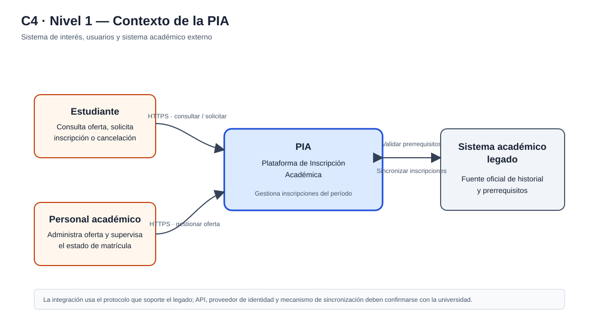
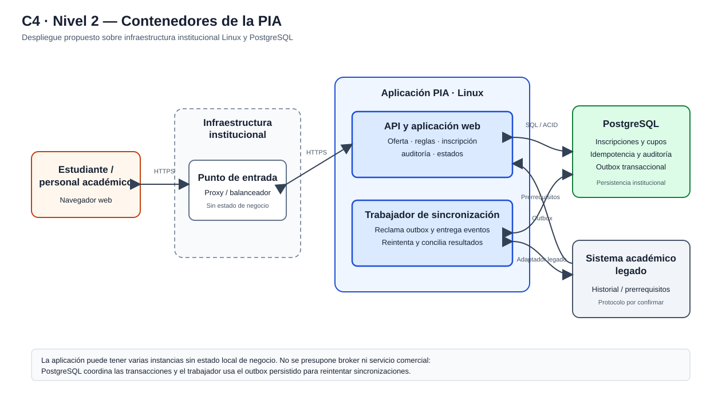
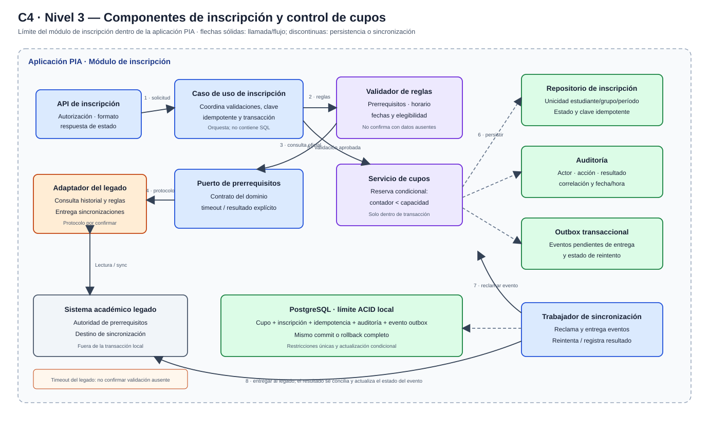

# Actividad 2. Diseño de la estructura arquitectónica

**Estudiante:** Santiago Andres Fonseca Rojas  
**Documento:** 1023890893  
**Caso:** Plataforma de Inscripción Académica (PIA)  
**Rama de trabajo:** `dev_sfonseca93`

## 1. Estilo arquitectónico seleccionado

Se propone un **monolito modular con arquitectura hexagonal (puertos y adaptadores), organizado en capas**. La PIA se construye y despliega como una aplicación institucional, pero mantiene módulos y límites explícitos entre presentación, casos de uso, dominio y adaptadores de infraestructura.

La propuesta no presupone un lenguaje, framework, balanceador, broker ni producto comercial específico. Debe ejecutarse sobre Linux y PostgreSQL institucionales. La aplicación puede ejecutarse en una o más instancias detrás de un punto de entrada institucional; el estado de negocio se conserva en PostgreSQL compartido, no en la memoria de una instancia.

### Justificación frente a las alternativas

| Alternativa | Ventajas | Costos o riesgos para este caso | Evaluación |
|---|---|---|---|
| Monolito modular hexagonal (seleccionado) | Una transacción local puede proteger la inscripción, la idempotencia, el contador de cupos y el evento de salida. Los módulos permiten aislar reglas y sustituir adaptadores. Despliegue y monitoreo más simples para el equipo institucional. | El despliegue y escalado son de la aplicación completa; requiere disciplina para evitar dependencias entre módulos. | Mejor equilibrio entre consistencia, evolución y capacidad de operación del equipo de cuatro desarrolladores y un administrador. |
| Microservicios | Despliegue y escalado independientes por servicio; aislamiento de fallas entre servicios. | Agrega llamadas de red, despliegues, observabilidad y coordinación operativa. La consistencia de cupos y la idempotencia cruzarían límites distribuidos; excede la necesidad demostrada y aumenta la carga del equipo. | No se selecciona para la primera versión. Se reconsideraría ante necesidades medidas de escalado o aislamiento que no se resuelvan modularizando y replicando la aplicación. |
| Monolito en capas sin límites modulares explícitos | Fácil de iniciar y desplegar. | Las reglas de matrícula pueden quedar acopladas a la interfaz y a la base de datos, dificultando pruebas y cambios de reglas; los adaptadores externos se vuelven difíciles de sustituir. | Se conserva la sencillez de despliegue, pero no se recomienda la ausencia de límites internos. |

### Principios estructurales

1. **El dominio de inscripciones es dueño de sus invariantes.** Solo el caso de uso de inscripción puede confirmar una inscripción y modificar el contador de cupos.
2. **El legado se accede mediante un puerto.** El adaptador encapsula el protocolo real del sistema académico, cuyos detalles deben confirmarse con sus responsables; el dominio no depende de ese protocolo.
3. **PostgreSQL es la autoridad de las inscripciones del período administradas por la PIA.** El sistema legado conserva autoridad sobre historial académico y prerrequisitos.
4. **No se confirma una validación académica no realizada.** Si el legado no permite comprobar un prerrequisito requerido, la solicitud se informa como pendiente de validación o no procesable, no como inscripción confirmada.
5. **El Escenario B forma parte del diseño.** Las consultas se prueban con 1.800 estudiantes concurrentes; el control de cupos y la idempotencia se prueban con solicitudes concurrentes y hasta cinco reintentos de la misma operación.

## 2. Nivel 1 — Diagrama de contexto

El sistema de interés es la PIA. Los estudiantes consultan y gestionan sus inscripciones; el personal académico administra la oferta y supervisa su estado. La PIA consulta al sistema académico legado para prerrequisitos y sincroniza con él las inscripciones. La universidad no ha especificado un proveedor de identidad ni un protocolo de integración; por ello no se introduce un sistema externo adicional en el diagrama.

## 3. Nivel 2 — Diagrama de contenedores

| Contenedor | Responsabilidad | Datos o interfaz |
|---|---|---|
| Aplicación web del estudiante/personal | Presentar oferta, permitir solicitudes y mostrar estados; no decide por sí sola si hay cupo ni si se cumplen prerrequisitos. | Interfaz web HTTPS hacia la API de la PIA. |
| Aplicación PIA | Aplicación desplegable que contiene módulos de oferta, reglas académicas, inscripciones, auditoría e integración. Atiende consultas y escrituras, y ejecuta el trabajador de sincronización. | API HTTPS y proceso de trabajo; el trabajador puede ejecutarse en la misma aplicación y reclamar tareas persistidas. |
| PostgreSQL institucional | Persistir oferta local necesaria para el período, inscripciones, claves de idempotencia, auditoría y outbox transaccional. | Transacciones ACID; restricciones únicas y actualización condicional de cupos. |
| Sistema académico legado | Fuente oficial del historial y los prerrequisitos; recibe sincronizaciones de las inscripciones que administra la PIA. | Integración por el mecanismo que el legado soporte, pendiente de confirmar; no se presupone una API específica. |

El punto de entrada (proxy inverso o balanceador institucional) puede distribuir tráfico entre instancias de la aplicación, pero no contiene estado de negocio. No se agrega un broker: la tabla outbox y un trabajador de la propia aplicación cubren la entrega recuperable sin sumar un producto que el equipo deba operar. Las instancias comparten PostgreSQL y el control de concurrencia se resuelve en la base de datos.

## 4. Nivel 3 — Componentes de inscripción y control de cupos

El límite de componentes se centra en el módulo de inscripción. Las flechas y responsabilidades se detallan en el diagrama.

### Responsabilidad de componentes

| Componente | Responsabilidad y límite |
|---|---|
| API de inscripción | Autenticar/autorizar la operación con los mecanismos institucionales disponibles, validar la forma de la solicitud y devolver el estado de negocio; no declara cupos por cuenta propia. |
| Caso de uso de inscripción | Coordinar idempotencia, consulta de prerrequisitos, validaciones locales y la transacción que confirma la inscripción. |
| Validador de reglas | Comprobar conflictos de horario y reglas locales; usa las inscripciones activas del estudiante y la oferta de la PIA. Los prerrequisitos se consultan al puerto del legado. |
| Servicio de cupos | Dentro de la transacción, reserva el cupo mediante una actualización condicional del grupo (`enrolled_count < capacity`) y persiste la inscripción. Un resultado sin filas actualizadas significa que no hay cupo. |
| Repositorio de inscripciones / idempotencia | Persiste solicitudes e inscripciones, con una restricción única por clave de idempotencia y una restricción de unicidad de estudiante, grupo y período según las reglas de matrícula. Una repetición devuelve el resultado original. |
| Adaptador del sistema académico | Implementa el puerto para consultar prerrequisitos y transmitir eventos de inscripción/cancelación. Aplica timeout y traduce errores del protocolo externo a resultados explícitos. |
| Outbox y trabajador de sincronización | El evento se guarda en la misma transacción que la inscripción. Un trabajador reclama eventos pendientes, los envía y marca éxito o próximo reintento. Un identificador estable permite que reintentar no duplique el efecto en el destino cuando el legado permita idempotencia o consulta de conciliación. |
| Auditoría | Registra actor o identidad de servicio, operación, fecha, identificador de correlación y resultado. Los registros de negocio relevantes se escriben junto con el cambio transaccional; fallas de auditoría no se ocultan como éxito. |
| PostgreSQL | Impone la atomicidad, unicidad y bloqueo necesarios para proteger la capacidad y evitar duplicados bajo concurrencia. |

## 5. Límites transaccionales

### Inscripción

1. La API recibe la solicitud con una clave de idempotencia estable. El caso de uso comprueba si ya existe un resultado para dicha clave; si existe, devuelve ese resultado.
2. Antes de confirmar, consulta el sistema legado para la validación oficial de prerrequisitos. Si no responde, no crea una confirmación académica; devuelve un estado explícito de validación no disponible y permite reintento conforme a la política del servicio.
3. Con la validación disponible, una transacción de PostgreSQL vuelve a comprobar las reglas locales dependientes de las inscripciones activas y ejecuta atómicamente: registrar la clave/resultado idempotente, reservar el cupo de forma condicional, insertar la inscripción, registrar auditoría y crear el evento outbox.
4. Si cualquier operación transaccional falla —incluida la restricción de unicidad— se hace rollback completo. La respuesta se construye a partir del resultado persistido, no de una lectura previa de disponibilidad.
5. Solo después del commit la PIA informa que aceptó la inscripción localmente. La interfaz distingue ese estado de la sincronización con el legado; no afirma que el legado ya la recibió si el evento sigue pendiente.

La consulta al legado no se mantiene dentro de una transacción de base de datos abierta: evita retener bloqueos durante una llamada de red. Como la información del legado puede cambiar entre la consulta y el commit, el contrato de integración debe definir con el responsable del legado la vigencia de la respuesta y el tratamiento de cambios concurrentes. La PIA no puede garantizar una reserva distribuida atómica con un sistema externo que no ofrezca ese mecanismo.

### Cancelación y sincronización

- La cancelación verifica el período permitido y, en una sola transacción, cambia el estado una sola vez, libera el cupo, registra auditoría y añade el evento de cancelación al outbox. Una repetición idempotente no libera el cupo por segunda vez.
- La transacción local finaliza antes de la llamada al legado. La sincronización ocurre de forma recuperable desde el outbox y conserva el estado `pendiente`, `enviado` o `error reintentable`; un fallo externo no revierte una transacción local ya confirmada.
- El legado puede estar fuera de servicio hasta 40 minutos. Durante la interrupción, las validaciones que dependan de él no se presentan como exitosas; los eventos locales ya confirmados permanecen identificados y pendientes de sincronización.
- Se requiere acordar con el responsable del sistema legado la semántica de acuse, la clave de idempotencia o mecanismo de consulta/reconciliación y los límites de reintento. Hasta conocer ese contrato, la PIA no puede asegurar entrega exactamente una vez en el sistema externo; sí puede evitar duplicar su propia inscripción y detectar eventos no conciliados.

## 6. Mecanismos de comunicación

| Comunicación | Mecanismo propuesto | Manejo de fallas |
|---|---|---|
| Navegador ↔ API PIA | HTTPS, solicitud/respuesta. Consultas y comandos separados por rutas y casos de uso. | Timeout de cliente explícito; reintentos de comandos con la misma clave de idempotencia. |
| API / casos de uso ↔ PostgreSQL | Acceso transaccional local mediante repositorios. | Rollback ante error; error explícito a la interfaz; restricciones de unicidad como última defensa frente a carreras. |
| Caso de uso ↔ legado para prerrequisitos | Llamada a través de puerto y adaptador, usando el protocolo que se acuerde. | Timeout y manejo de indisponibilidad. No confirma prerrequisitos ni inscripciones que dependan de una respuesta ausente. |
| Trabajador PIA ↔ outbox | Lectura y reclamación de lotes pendientes en PostgreSQL; varias instancias pueden coordinarse mediante bloqueo de filas. | Reintentos con espera progresiva y estado de error visible para operación; eventos no se descartan silenciosamente. |
| Trabajador PIA ↔ sistema legado | Entrega de eventos de sincronización mediante el adaptador. | Identificador de operación estable, reintento y conciliación; no asumir exactamente-una-vez sin soporte del sistema destino. |

## 7. Respuesta arquitectónica al Escenario B

- **Aumento a 1.800 estudiantes concurrentes:** la aplicación no guarda estado de sesión de negocio local a una instancia, por lo que puede desplegarse en varias instancias institucionales detrás del punto de entrada. La prueba de aceptación mide p95 ≤ 2 segundos para consultas de asignaturas bajo el perfil de carga definido y reporta también errores y recursos utilizados.
- **Competencia por el último cupo:** PostgreSQL serializa la actualización de la fila del grupo. Solo se incrementa el contador si todavía es menor que la capacidad autorizada. La actualización y la inserción de inscripción se realizan en una misma transacción; una falla revierte ambas. Una lectura de disponibilidad nunca reserva ni garantiza el cupo.
- **Hasta cinco reintentos:** la clave de idempotencia enlaza envíos repetidos con la respuesta de la primera operación. Las restricciones únicas en PostgreSQL complementan la lógica y evitan duplicados aun si solicitudes equivalentes llegan simultáneamente.
- **Degradación:** las consultas y los comandos tienen métricas separadas; los timeouts de legado evitan ocupar recursos indefinidamente. La indisponibilidad del legado restringe solo las operaciones que requieren su validación; el sistema informa el estado al estudiante y no simula una aceptación.

## 8. Correspondencia con los drivers de la Actividad 1

| Driver | Decisión estructural que lo atiende |
|---|---|
| D-01 Consistencia de cupos | Actualización condicional y transacción en PostgreSQL; el dominio de inscripciones es el único propietario del cambio de capacidad. |
| D-02 Idempotencia | Clave y resultado de idempotencia persistidos, más restricciones únicas en PostgreSQL. |
| D-03 Rendimiento | Aplicación sin estado local de negocio, posibilidad de varias instancias, consultas de lectura separadas de comandos y prueba de carga de 1.800 concurrentes. |
| D-04 Disponibilidad y recuperación | Persistencia institucional, componentes reemplazables y operación recuperable; los objetivos RTO/RPO deberán demostrarse en la estrategia operativa y pruebas posteriores. |
| D-05 Integración oficial | Puerto/adaptador al legado, validación obligatoria antes de confirmar cuando aplique, outbox y conciliación de eventos. |
| D-06 Seguridad y auditoría | Autorización en la API y registros auditables asociados a operaciones de negocio. |
| D-07 Mantenibilidad | Módulos con dependencias explícitas y reglas de dominio independientes del protocolo web y del legado. |

## 9. Supuestos y decisiones pendientes de validar

1. Los responsables técnicos del legado deben confirmar el protocolo disponible, las operaciones soportadas, límites de uso, semántica de acuse y opciones de idempotencia o conciliación.
2. Debe acordarse qué estado de inscripción entiende la universidad como confirmación oficial y qué texto se muestra mientras la sincronización está pendiente.
3. La universidad debe definir los mecanismos institucionales de identidad, autorización y operación del punto de entrada; no se presupone la existencia de un proveedor particular.
4. La capacidad disponible de PostgreSQL, sus respaldos, alta disponibilidad y topología Linux deben comprobarse mediante pruebas para alcanzar disponibilidad ≥ 99,9%, RTO ≤ 30 minutos y RPO ≤ 5 minutos. El estilo arquitectónico por sí solo no demuestra esas metas.

## 10. Diagramas vectoriales

- [Nivel 1 — Contexto](diagramas/actividad2-contexto.svg)
- [Nivel 2 — Contenedores](diagramas/actividad2-contenedores.svg)
- [Nivel 3 — Componentes de inscripción y cupos](diagramas/actividad2-componentes.svg)
